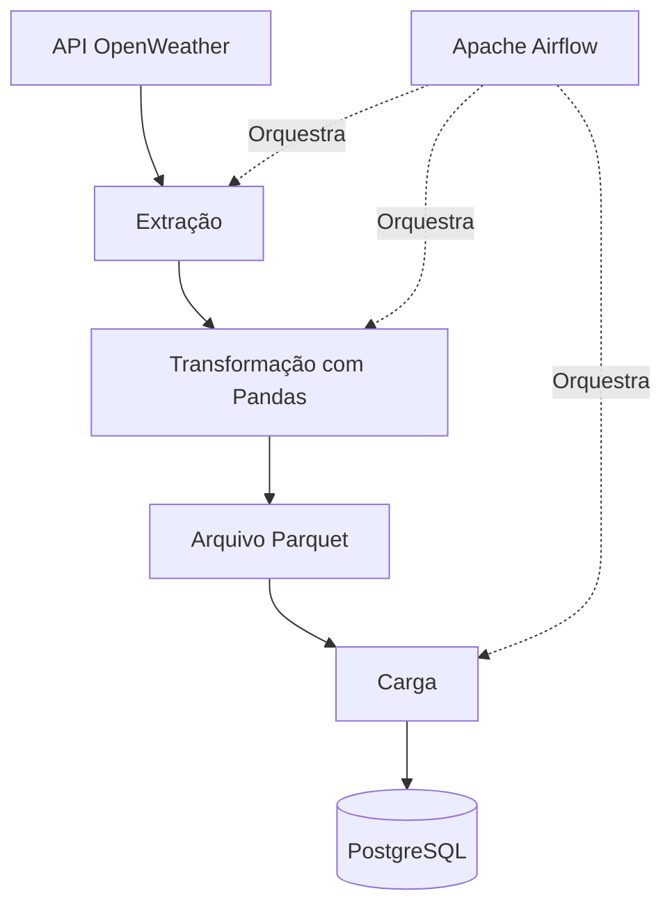

# 🌦️ Pipeline ETL de Dados Meteorológicos

Projeto de Engenharia de Dados que coleta informações meteorológicas por meio da API OpenWeather, transforma os dados utilizando Python e Pandas, armazena os dados intermediários em formato Parquet e carrega os resultados no PostgreSQL.

O fluxo de processamento é orquestrado pelo Apache Airflow e configurado para execução automática a cada hora.

## 📌 Sobre o projeto

Este projeto foi desenvolvido com o objetivo de praticar conceitos fundamentais de Engenharia de Dados, incluindo integração com APIs, desenvolvimento de pipelines ETL, transformação de dados, armazenamento, orquestração de workflows e utilização de bancos de dados relacionais.

A coleta é realizada para a cidade de **João Monlevade, Minas Gerais, Brasil**.

### Principais funcionalidades

- **Extração de dados:** coleta informações meteorológicas por meio da API OpenWeather.
- **Transformação de dados:** utiliza Python e Pandas para processar e estruturar os dados.
- **Armazenamento intermediário:** utiliza arquivos Parquet para persistência dos dados processados.
- **Carga de dados:** armazena os dados no PostgreSQL.
- **Orquestração:** automatiza as etapas do pipeline utilizando Apache Airflow.
- **Containerização:** utiliza Docker Compose para executar os serviços necessários.
- **Gerenciamento de configurações:** utiliza variáveis de ambiente para armazenar credenciais e configurações.

## 🏗️ Arquitetura do projeto



### Fluxo ETL

1. **Extract (Extração):** realiza requisições à API OpenWeather para obter informações meteorológicas.
2. **Transform (Transformação):** processa os dados extraídos e organiza as informações em um DataFrame.
3. **Armazenamento intermediário:** salva os dados processados em formato Parquet.
4. **Load (Carga):** lê os dados armazenados e os carrega no PostgreSQL.
5. **Orquestração:** o Apache Airflow gerencia a execução das etapas, incluindo tentativas de reexecução em caso de falhas.

## 🛠️ Tecnologias utilizadas

| Tecnologia | Finalidade |
|---|---|
| Python | Desenvolvimento do pipeline ETL |
| Pandas | Manipulação e transformação de dados |
| Requests | Requisições HTTP à API |
| Apache Airflow 3.1.7 | Orquestração do pipeline |
| PostgreSQL 16 | Armazenamento dos dados |
| Parquet | Armazenamento colunar intermediário |
| SQLAlchemy | Integração com o banco de dados |
| Docker Compose | Execução e gerenciamento dos serviços |
| uv | Gerenciamento de dependências Python |
| python-dotenv | Leitura de variáveis de ambiente |

## ⚙️ Pré-requisitos

Antes de executar o projeto, é necessário ter instalado:

- [Git](https://git-scm.com/)
- [Docker Desktop](https://www.docker.com/products/docker-desktop/)
- [Python](https://www.python.org/) — versão compatível com o projeto
- [uv](https://docs.astral.sh/uv/)
- Uma chave de API do [OpenWeather](https://openweathermap.org/api)

## 🚀 Como executar o projeto

### 1. Clonar o repositório

```bash
git clone https://github.com/joaoassum/Pipeline_ETL_Weather.git
cd Pipeline_ETL_Weather
```

### 2. Configurar as variáveis de ambiente

Crie o diretório `config` e o arquivo `.env` dentro dele:

```text
config/.env
```

Adicione a chave da API:

```env
API_KEY=sua_chave_da_openweather
```

Verifique também as configurações exigidas pelo Docker Compose e garanta que as variáveis necessárias estejam disponíveis dentro dos contêineres do Airflow.

**Importante:** não compartilhe chaves de API, senhas ou outras credenciais no GitHub. Mantenha os arquivos `.env` fora do controle de versão.

### 3. Inicializar o ambiente Docker

Com o Docker Desktop em execução, inicialize o ambiente do Airflow:

```bash
docker compose up airflow-init
```

Após a conclusão da inicialização, execute os serviços:

```bash
docker compose up -d
```

Para verificar o estado dos contêineres:

```bash
docker compose ps
```

### 4. Acessar o Apache Airflow

Abra o endereço abaixo no navegador:

[http://localhost:8080](http://localhost:8080)

Utilize as credenciais configuradas para o ambiente local.

Localize a DAG `weather_pipeline`, habilite-a se necessário e execute uma nova execução para iniciar o pipeline.

### 5. Verificar os dados gerados

Após uma execução bem-sucedida, o pipeline gera um arquivo Parquet intermediário no caminho configurado:

```text
data/weather_data.parquet
```

Os dados processados são carregados no PostgreSQL, na tabela:

```text
weather_jm
```

A porta `5433` é utilizada para acessar o PostgreSQL a partir da máquina host, conforme a configuração do Docker Compose.

## 🔄 Configuração da execução

A DAG do Airflow possui as seguintes configurações:

| Configuração | Valor |
|---|---|
| Identificador da DAG | `weather_pipeline` |
| Agendamento | A cada hora |
| Tentativas em caso de falha | 2 |
| Intervalo entre tentativas | 5 minutos |
| Catchup | Desabilitado |

Essas configurações permitem executar o pipeline periodicamente e realizar novas tentativas quando uma tarefa falha.

## 🎯 Conceitos praticados

Com este projeto, são explorados conceitos importantes para Engenharia de Dados:

- Desenvolvimento de pipelines ETL com Python.
- Consumo de APIs REST.
- Transformação e organização de dados com Pandas.
- Armazenamento de dados em formato Parquet.
- Integração e persistência em bancos de dados relacionais.
- Orquestração de tarefas com Apache Airflow.
- Containerização de serviços com Docker Compose.
- Gerenciamento de dependências e configurações.
- Organização de um projeto de dados em módulos.

## 🔮 Melhorias futuras

Algumas evoluções possíveis para o projeto:

- Implementação de testes automatizados.
- Validação da qualidade e consistência dos dados.
- Melhoria do sistema de logs e monitoramento.
- Implementação de estratégias de carga incremental e histórico meteorológico.
- Integração com ferramentas de CI/CD.
- Desenvolvimento de um dashboard no Power BI para visualizar tendências meteorológicas.

---

*Projeto desenvolvido como parte dos estudos em Engenharia de Dados, com foco em extração, transformação, armazenamento e orquestração de dados.*
